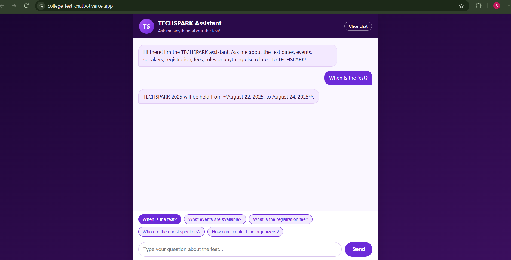
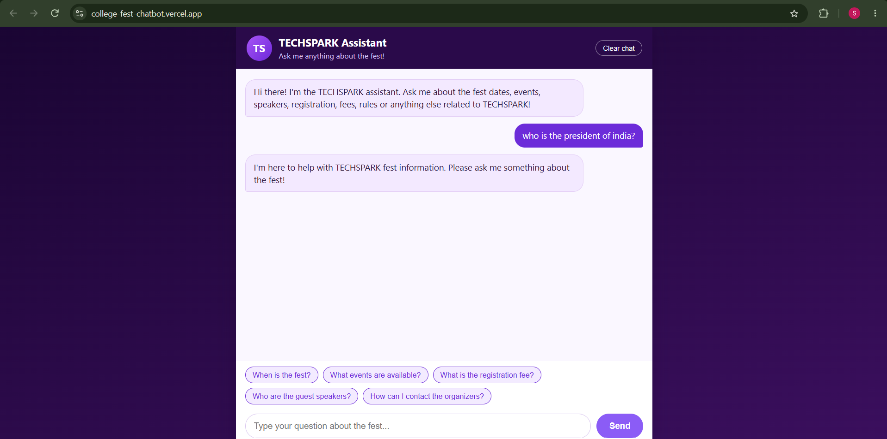

# TECHSPARK College Fest Chatbot

An AI-powered chatbot that answers student questions about the TECHSPARK college technical fest. Built with FastAPI, Google Gemini, and vanilla JavaScript, this project demonstrates an end-to-end AI application with configurable context, input validation, error handling, automated tests, and deployment on Vercel.

**Live Demo:** https://college-fest-chatbot.vercel.app/  
**GitHub Repository:** https://github.com/Sivasindhuja/collegeFest-chatbot

> [!IMPORTANT]
> **Demo uses mock data.** The fest information currently in the repository is sample data, not verified official information. Dates, venues, events, speakers, fees, registration links, and contacts must be replaced with confirmed details before real-world use.

---

## Table of Contents

- [Project Overview](#project-overview)
- [Features](#features)
- [Technology Stack](#technology-stack)
- [Architecture and Request Flow](#architecture-and-request-flow)
- [Why No RAG?](#why-no-rag)
- [Configurable Context and System Prompt](#configurable-context-and-system-prompt)
- [Safety and Security Considerations](#safety-and-security-considerations)
- [Error Handling](#error-handling)
- [Rate Limiting](#rate-limiting)
- [Latency and Performance](#latency-and-performance)
- [Project Structure](#project-structure)
- [Getting Started](#getting-started)
- [Environment Variables](#environment-variables)
- [Running Tests](#running-tests)
- [Screenshots](#screenshots)
- [Limitations and Future Improvements](#limitations-and-future-improvements)

## Project Overview

Students often need quick access to event details such as dates, venues, registration information, competitions, speakers, and rules.

The TECHSPARK College Fest Chatbot provides a conversational interface where students can ask questions about the fest and receive answers generated by Google Gemini using the supplied fest information.

The project focuses on implementing a complete application workflow, from frontend interaction and backend validation to AI integration, error handling, automated testing, and cloud deployment.

## Features

- **Conversational interface:** Ask questions about TECHSPARK through a simple web-based chat interface.
- **Context-grounded responses:** Supplies fest information directly to Gemini when generating answers.
- **Configurable knowledge:** Fest information is maintained separately in a JSON file.
- **Configurable system instructions:** Assistant behavior can be adjusted without rewriting the backend.
- **Basic topic filtering:** Uses a keyword-based application check to reject questions that do not appear to concern the fest.
- **Input validation:** Rejects empty, whitespace-only, and excessively long questions.
- **Error handling:** Returns user-friendly messages when the AI service or configuration is unavailable.
- **Rate limiting:** Implements a configurable, in-memory request limit.
- **Automated tests:** Tests API behavior using mocked Gemini calls.
- **Cloud deployment:** Frontend and backend are deployed through a single Vercel project.

## Technology Stack

| Component | Technology |
|---|---|
| Frontend | HTML5, CSS3, Vanilla JavaScript |
| Backend | Python, FastAPI |
| Request validation | Pydantic |
| Language model | Google Gemini |
| Gemini integration | `google-genai` SDK |
| Configuration | JSON, text files, environment variables |
| Testing | Pytest, FastAPI TestClient, mocked Gemini API |
| Deployment | Vercel |

## Architecture and Request Flow

```text
                   Student
                      |
                      v
             Browser Chat Interface
             (HTML, CSS, JavaScript)
                      |
                      | POST /api/chat
                      v
                FastAPI Backend
                  (api/index.py)
                      |
                      v
                Input Validation
                      |
                      v
             Fest-Topic Keyword Check
                 /           \
          Unrelated          Relevant
              |                 |
              v                 v
       Return Refusal     Load Configuration
                          /              \
                         v                v
                  System Prompt      Fest Data JSON
                         \                /
                          \              /
                           v            v
                         Google Gemini
                               |
                               v
                       Generated Answer
                               |
                               v
                       JSON API Response
                               |
                               v
                       Browser Chat UI
```

### Request flow

1. The frontend sends a student's question to `POST /api/chat`.
2. FastAPI validates the request using Pydantic.
3. A keyword-based check determines whether the question appears related to TECHSPARK. Questions that fail this check are refused without calling Gemini.
4. The backend loads the system prompt and fest information.
5. The prompt instructions, fest data, and student question are supplied to Gemini.
6. The backend returns the generated answer to the frontend in JSON format.
7. If a handled error occurs, the API returns an appropriate status code and a user-friendly response.

The application exposes two main endpoints:

| Endpoint | Method | Purpose |
|---|---|---|
| `/api/health` | GET | Checks whether the API is responding |
| `/api/chat` | POST | Processes a student's question |

Example request:

```bash
curl -X POST https://college-fest-chatbot.vercel.app/api/chat \
  -H "Content-Type: application/json" \
  -d '{"question":"What events are available?"}'
```

Example response structure:

```json
{
  "answer": "..."
}
```

The actual answer depends on the supplied fest data and the model's response.

The Gemini API key is configured on the server and is not included in the frontend JavaScript.

## Why No RAG?

Retrieval-Augmented Generation (RAG) is useful when an application needs to retrieve relevant information from a large collection of documents. However, it also introduces additional components, such as document chunking, embeddings, a retrieval mechanism, and potentially a vector database.

For this project, the fest information is maintained in a relatively small, structured JSON file. Supplying this context directly to Gemini was a simpler approach for the project's scope.

### Reasons for choosing direct context injection

- The information is small enough to include directly in the prompt.
- The data has a predictable structure, including dates, events, speakers, registration information, and contacts.
- There was no immediate need for semantic search across a large document collection.
- The implementation avoids the additional infrastructure and complexity of a RAG pipeline.

### Trade-offs

Direct context injection also has limitations:

- The fest information is sent with each relevant model request.
- Larger context can increase token usage and may contribute to response latency.
- As the knowledge base grows, including all information in every request may become inefficient.
- The approach still depends on the model following its instructions and generating an accurate answer from the supplied context.

**Engineering decision:** Direct context injection was chosen because it matched the size and structure of the available data. RAG could be considered if the application later needs to handle a much larger collection of documents.

## Configurable Context and System Prompt

The application separates the information the chatbot uses from the instructions that define how it should respond.

### 1. Fest information — `config/fest_data.json`

This file contains the information available to the chatbot, such as:

- Fest name and description
- Dates and venue
- Events and descriptions
- Speakers and affiliations
- Registration details
- Rules
- Contact information

To update the chatbot's knowledge, edit this JSON file rather than hardcoding event information into the application logic.

The backend validates the data structure before using it. Missing or invalid configuration is handled with a safe service error.

### 2. System instructions — `config/system_prompt.txt`

This file defines the chatbot's role and response rules.

The current instructions tell the assistant to:

- Answer questions about TECHSPARK and its activities.
- Use the supplied fest information for factual answers.
- Say when requested information is unavailable.
- Avoid inventing event details.
- Refuse unrelated questions.
- Not follow user instructions that attempt to override its rules.
- Not reveal internal instructions or API keys.

Separating the prompt from the backend makes it easier to refine the assistant's behavior without changing the application code.

**Deployment note:** The configuration files are cached per running Python instance. After changing them in the repository, redeploy the application so the updated version is available in production.

## Safety and Security Considerations

### Prompt injection

The system prompt contains instructions intended to prevent user messages from overriding the assistant's rules or persuading it to reveal internal instructions and secrets.

This is a **basic defensive measure, not a complete prompt-injection solution**.

System-prompt instructions alone cannot guarantee that a language model will resist every adversarial input. The project has not undergone a dedicated prompt-injection evaluation or security audit.

Further work could include a dedicated set of adversarial test cases, stronger separation between trusted context and untrusted user input, and additional validation of model outputs where appropriate.

### Out-of-scope questions

The application uses two layers to limit unrelated responses:

1. **Application-level keyword check:** Questions that do not match the configured fest-related keywords are refused before the Gemini API is called.
2. **System-prompt instructions:** Gemini is instructed to answer only fest-related questions.

These mechanisms provide a basic topic restriction, but they are not a complete topic-classification system. A relevant question phrased unexpectedly could be rejected, while an unrelated question containing a matching keyword could pass the initial check.

The system prompt also instructs the model not to invent missing information. This is a behavioral instruction rather than a guarantee that every answer will be factually correct.

### API key protection

The Gemini API key is read from a server-side environment variable. It should never be hardcoded into frontend JavaScript, committed to the repository, or shared in screenshots or logs.

For local development, use a `.env` file that is excluded from version control. For Vercel, configure the key through the project's environment-variable settings.

## Error Handling

The backend maps several failure conditions to safe, user-facing responses rather than exposing raw provider errors.

| Scenario | Implemented behavior | Automated test coverage |
|---|---|---|
| Missing Gemini API key | Returns a service-unavailable response | Explicitly tested |
| Gemini request timeout | Returns a service-unavailable response | Explicitly tested |
| Gemini rate limit or quota response (HTTP 429) | Returns a rate-limit response | Explicitly tested |
| Application rate limit exceeded | Returns HTTP 429 with a friendly message | Explicitly tested |
| Unexpected provider error | Returns a safe error response | Explicitly tested |
| Empty Gemini response | Returns a fallback message | Explicitly tested |
| Invalid fest JSON | Returns a service-unavailable response | Explicitly tested |
| Missing system prompt | Returns a service-unavailable response | Explicitly tested |
| Unrelated question rejected by keyword check | Returns a polite refusal without calling Gemini | Explicitly tested |
| Invalid Gemini API key (HTTP 401/403) | Maps the error to a configuration-related response | Implemented, but not explicitly tested |
| Other Gemini API errors | Maps the error to a service-unavailable response | General handling implemented; distinct service-unavailable status not explicitly tested |
| Blocked model response | Treated as an unusable response and handled safely | Implemented |

The automated tests mock Gemini calls, so they verify application behavior without requiring a live API key or consuming Gemini quota. They do not establish live model quality, availability, or production reliability.

## Rate Limiting

The backend implements an in-memory rate limit to reduce repeated requests from the same client IP.

Default settings:

- **Maximum requests:** 10
- **Time window:** 60 seconds

These values can be adjusted using environment variables.

The implementation is intentionally lightweight. Since the rate-limit counters live in application memory, they are not shared across serverless instances and may reset when an instance restarts.

Consequently, this is a **best-effort rate limit**, not a globally enforced or production-grade distributed rate-limiting solution.

## Latency and Performance

Latency and other performance metrics were **not measured** during this project.

The focus was on implementing the end-to-end application workflow rather than benchmarking response times, optimizing the user experience, or validating production readiness.

For relevant questions, the backend makes an external Gemini API request. Response time may therefore vary depending on network conditions, model generation, and serverless runtime behavior.

No response-time figures or performance guarantees are claimed.

Measuring end-to-end latency, backend processing time, and token usage would be a useful next step before using the application for a real event.

## Project Structure

```text
collegeFest-chatbot/
├── api/
│   └── index.py             # FastAPI endpoints and Gemini integration
├── config/
│   ├── fest_data.json       # Mock fest information
│   └── system_prompt.txt    # Assistant instructions
├── public/
│   ├── index.html           # Chat interface markup
│   ├── style.css            # Chat interface styling
│   └── script.js            # Browser-side chat logic
├── tests/
│   ├── conftest.py          # Test fixtures
│   └── test_api.py          # API tests using mocked Gemini calls
├── .env.example
├── .gitignore
├── requirements.txt
├── vercel.json
└── README.md
```

## Getting Started

### Prerequisites

- Python 3.11 or newer
- A Google Gemini API key for live model responses
- Git

### 1. Clone the repository

```bash
git clone https://github.com/Sivasindhuja/collegeFest-chatbot.git
cd collegeFest-chatbot
```

### 2. Create a virtual environment

```bash
python -m venv .venv
```

Activate it on Windows PowerShell:

```powershell
.venv\Scripts\Activate.ps1
```

On macOS or Linux:

```bash
source .venv/bin/activate
```

### 3. Install dependencies

```bash
pip install -r requirements.txt
pip install pytest httpx
```

### 4. Configure environment variables

Copy `.env.example` to `.env` and provide your own Gemini API key and other required variables


### 5. Run the backend

```bash
uvicorn api.index:app --reload --port 8000
```

The health endpoint should be available at:

```text
http://127.0.0.1:8000/api/health
```

For local browser testing, serve the frontend from a local origin allowed by the backend's CORS configuration and ensure its API request resolves to the running FastAPI server. The deployed application can also be used for browser-based testing.

## Environment Variables

| Variable | Purpose | Default |
|---|---|---|
| `GEMINI_API_KEY` | Server-side Gemini API key | Required |
| `GEMINI_MODEL` | Gemini model name | `gemini-3.6-flash` |
| `GEMINI_TEMPERATURE` | Generation temperature | `0.2` |
| `GEMINI_MAX_OUTPUT_TOKENS` | Maximum generated output tokens | `400` |
| `CHAT_RATE_LIMIT_MAX` | Requests allowed in the rate-limit window | `10` |
| `CHAT_RATE_LIMIT_WINDOW_SECONDS` | Rate-limit window in seconds | `60` |

The values above describe the repository's configured defaults. The actual model and settings used in deployment depend on the environment variables configured in Vercel.

> **Implementation note:** Although `GEMINI_TIMEOUT_SECONDS` is documented in the example configuration, the current backend code should be checked to confirm that this variable is actually passed to the Gemini client. Do not assume that changing it necessarily changes the live request timeout.

## Running Tests

Run the automated test suite with:

```bash
python -m pytest tests/ -v
```

The tests mock the Gemini API, so a real API key and live Gemini quota are not required.

The current suite covers input validation, the health endpoint, successful response structure, topic-based refusal, rate limiting, missing API configuration, timeout and provider-error handling, empty model responses, and invalid or missing configuration files.


## Screenshots


### 1. Chatbot Interface and Fest Information

The main interface of the TECHSPARK Assistant, featuring suggested questions and an interactive chat experience for college fest-related queries.



### 2. Out-of-Scope Question Handling

The chatbot identifies unrelated questions and politely redirects users to TECHSPARK-related topics, demonstrating the application's topic-filtering mechanism.




## Limitations and Future Improvements

This project demonstrates an end-to-end implementation; it has not been validated as a production-ready event support system.

Potential next steps include:

- Replace mock fest data with verified information before any real-world use.
- Create dedicated prompt-injection tests and evaluate the effectiveness of the current defenses.
- Measure end-to-end latency, backend processing time, and token usage.
- Improve topic detection beyond a simple keyword-based check.
- Consider a shared rate limiter if the application needs to support meaningful production traffic.
- Add dedicated tests for invalid API keys and specific provider outage responses.
- Reconsider RAG if the knowledge base grows beyond what is practical to include directly in each prompt.

---

**Project status:** Implemented and deployed as a prototype. Performance benchmarking, comprehensive security testing, and production-readiness validation remain future work.